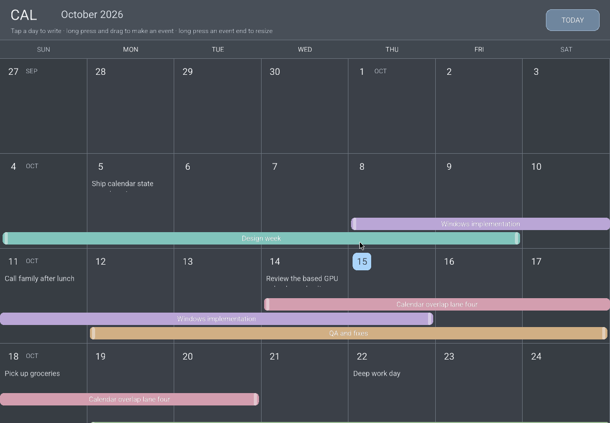
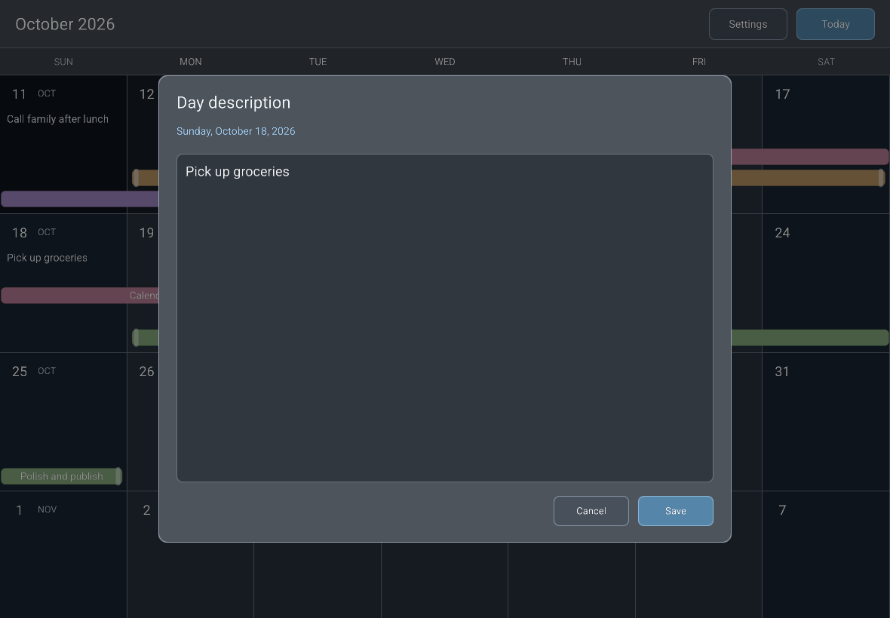
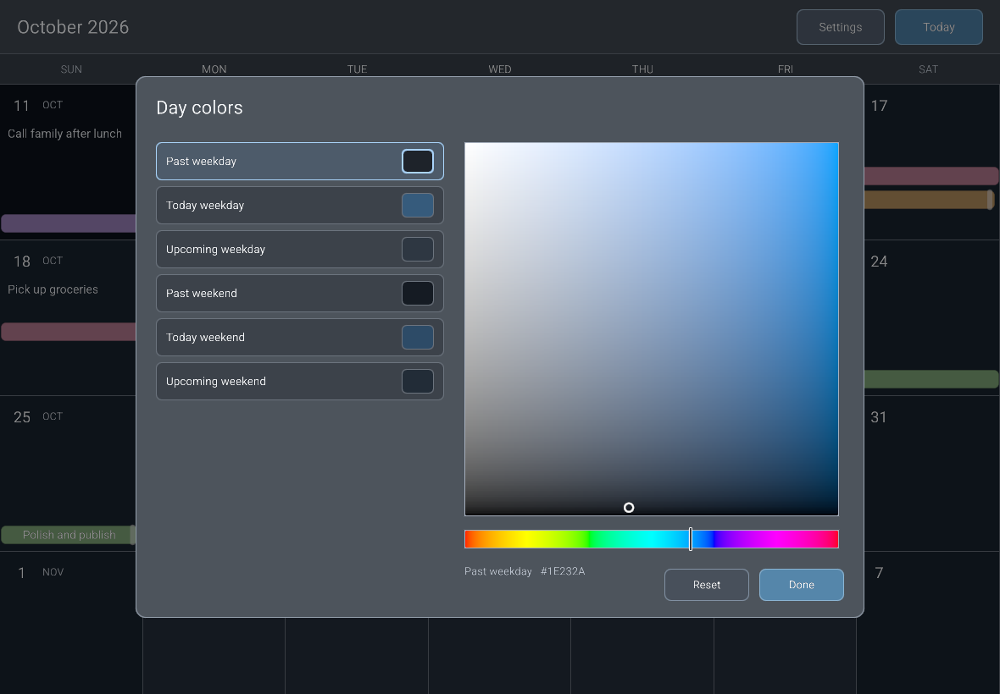

# cal-based

A native and Web calendar experiment built from the low-level capabilities in [`based`](https://github.com/xpjb/based).







## Calendar behavior

- One Sunday–Saturday week per row.
- Every day has an editable description.
- Events span inclusive date ranges and render as rounded strips along the bottom of each week.
- Overlapping events receive stable, bottom-up lanes. The first four lanes render.
- Type, spacing, hit areas, and editor controls scale with the display scale.
- Past, today, and upcoming weekdays and weekends have six distinct colors. Use **Settings** to change any of them.
- Hover, pressed, and dragging states are visible on every interactive calendar surface.
- Click a day or event strip to open its description editor. Clicking outside the editor closes it.
- With a mouse, drag a day immediately to create an event and drag an event endpoint immediately to resize it.
- On touch, long-press a day or endpoint before dragging.
- Drag an endpoint onto or past the other endpoint and release to delete the event.
- Use the mouse wheel or trackpad to move through continuous weeks. **Today** eases back with the current week aligned to the top; manual input stops the motion immediately.

The editor is a custom `based` widget. It stores text in a `ropey::Rope` and uses Sanscale's own layout for wrapping, hit testing, selection, caret motion, and rendering. `Ctrl+Enter` saves and `Escape` cancels.

## State design

All reads and mutations go through the separate `StateClient::request` and `StateClient::transact` operations. Both return a request ID. `CalendarState` applies transactions, writes JSON, and sends each requested or affected value through `based::EventSender<StateEvent>`. There is no response polling or full-state request.

Each visible or buffered date has a `DayWidget` that owns only its optional `DayRecord`. The calendar derives the interest window from scroll position, requests newly relevant dates, and drops day widgets outside that range. Day widgets stay passive: matching `Day` values set their text and memberships, while `Event` values keep those memberships current.

The calendar requests event records named by interested days and stores loaded `CalendarEvent` values directly. `CalendarEvent` implements `Widget` for matching user-event updates. Lane assignment remains calendar-wide because it depends on all visible events; the event module owns week segments, endpoint geometry, colors, and painting.

The stored model corresponds to:

```text
/year/month/day/description
/year/month/day/events/<event_id>
/events/<event_id>/start_date
/events/<event_id>/end_date
/events/<event_id>/description
/settings/day_colors/<past|today|upcoming>_<weekday|weekend>
```

Day-event memberships are rebuilt from the global event records when the file opens, so redundant paths cannot drift.

Native builds store the default file under the platform's local application-data directory. Set `CAL_BASED_DATA` to use a specific JSON file. Web builds currently keep calendar state in memory.

## Architecture

The application composes only these low-level `based` services:

- `Window`
- `Wgpu`
- `Sanscale`
- `Input`

Once the selected backend has a platform target, it injects the window, event sender, and target-independent `Wake` handle into one asynchronous initializer. That initializer awaits the GPU, then creates the text renderer, state client, and complete `App` in dependency order. The application requests relative wakeups through `Wake`; the selected backend uses its native or browser event-loop timer. The application has no partial `Runtime` state.

Every application widget receives one concrete `AppContext`, including only `&mut dyn StateClient` for state access. Widget-scoped mirrors consume broadcast `Event::User` responses, while the backing store and event sender stay inside `App`. The desktop app shell, calendar widget, day widgets, calendar events, editor widget, settings widget, reusable interactive surfaces, and GPU painter are separate modules. Buttons own their hover and press state. Calendar cells, events, endpoints, and text fields use the same explicit idle, hovered, pressed, and dragging surface states.

Rounded surfaces are single GPU quads. The fragment shader computes the radius, border, and antialias coverage, so controls do not depend on CPU polygon tessellation.

The widget tree, model, transaction vocabulary, and interval-lane assignment run unchanged on native targets and Web. Android can reuse the same application structure. Web persistence and clipboard integration remain future application services.

Networking and tailnet replication are intentionally not implemented in this experiment.

## Build and check

This repository pins a private `based` revision, so the build requires repository access and working GitHub SSH credentials.

```sh
cargo run
cargo build --target wasm32-unknown-unknown
./scripts/check.sh
./scripts/build-windows.sh
```

The release script writes:

```text
dist/cal-based-0.1.3-windows-x64.exe
dist/cal-based-0.1.3-windows-x64.exe.sha256
```

Rust checks compile every native target, run behavioral tests with Nextest, and use `cargo xwin` for the Windows target.
